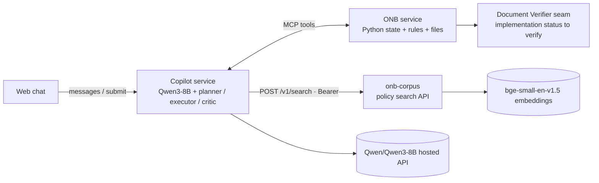

# iPe Merchant Onboarding Copilot — Technical Report

**Architecture, implementation, retrieval, agentic orchestration, evaluation and operations**

**Capstone Track B | Updated 26 November 2026**

Repository snapshot: analysis repository default branch inspected 26 November 2026.

Prepared for academic project submission. Institution, course, team and mentor details to be completed by authors.

<!-- PAGE BREAK -->

## 1. Introduction and problem definition

The iPe Merchant Onboarding Copilot is a Track B conversational workflow for collecting information and supporting evidence for one merchant shop. It combines a hosted Qwen/Qwen3-8B language model, policy-grounded retrieval, a constrained MCP tool surface and a deterministic Python onboarding service.

The core safety property is architectural: the language model may interpret, coordinate and explain, but it cannot decide eligibility, waive evidence, change merchant volume or activate a merchant. ONB remains the source of truth for application state and verdicts; a human iPe reviewer owns activation.

The current repository README records a 71-shop gold set with 50/50 development and 21/21 holdout replay passes. These are repository-reported results; this document does not claim an independent re-audit of every raw case log. The policy corpus contains 500 documents and 1,446 chunks. Hybrid retrieval at 800/120 achieved hit@4 0.958 and hit@8 1.000 on 24 fixed questions.

This refresh incorporates the analysis repository README and ADR-0001 as currently available on 26 November 2026. It supersedes the previous 21-page technical report and is structured as a 19-page submission document, including the cover.

<!-- PAGE BREAK -->

## 2. Product scope, actors and requirements

The merchant provides shop details and uploads evidence through a web chat. The frontend talks to the copilot; the copilot coordinates ONB and policy retrieval. ONB owns authoritative application data and deterministic rules. onb-corpus owns policy indexing and search. A human reviewer is responsible for activation.

The workflow collects shop_name, city, business_type, monthly_volume, payment_methods and stores_payer_phones; required documents are business_registration, owner_id, bank_proof and shopfront_photo. dpa_addendum is conditional on payer-phone storage. An optional note may be supplied.

The copilot asks for one pending item at a time. Submit is blocked while a required slot remains unresolved; the merchant can explicitly mark an unavailable document as missing. The verdict contains outcome, missing items, assignee, policy citations and a stable review ID. Later accepted evidence reruns the same rules without changing that ID.

Non-goals include automatic activation, policy waiver, volume manipulation, autonomous human-review bypass, model-authored document acceptance and fine-tuning model weights.

<!-- PAGE BREAK -->

## 3. System architecture

The solution consists of a thin web chat, the Copilot service, the deterministic ONB service and the separate onb-corpus retrieval service. The Copilot is the only conversational LLM service and MCP client. ONB is plain Python and contains the state machine, file state, rule engine and review-ID lifecycle.

The frontend communicates with the Copilot rather than calling ONB directly. The Copilot invokes ONB through five MCP tools and calls the corpus search API separately for policy passages. Retrieval supports explanations and citations; it does not calculate the verdict.

The architecture is intentionally asymmetric: ONB persists business state; the Copilot does not hold durable authoritative state between turns. This allows rule tests, retrieval tests and prompt tests to be evaluated independently.

<!-- PAGE BREAK -->

## 4. Service responsibilities and interfaces

Web chat: presents intake, uploads, review summary and verdict. The current README says the frontend is wired to the live Copilot happy path; conversation history is persisted in Postgres.

Copilot: receives each turn, classifies intent, applies bounded planner/executor/critic orchestration, calls permitted tools, retrieves policy passages when needed, and renders the response. The hosted chat model is Qwen/Qwen3-8B. No model weights are changed.

ONB: exposes the closed MCP tool surface; stores answers and files; owns field order, phase, pending field and review ID; runs deterministic rules on submit and when accepted evidence arrives after submission.

onb-corpus: maintains the policy pack and authenticated POST /v1/search endpoint. It owns query embedding, hybrid retrieval and ranking. Embeddings use bge-small-en-v1.5.

The repository README describes a document-verifier configuration with an LLM checker and a deterministic rules fallback. ADR-0001 describes the capstone verifier as mocked with format checks and fixture-based accept/reject. These descriptions differ; the deployed mode and current implementation should be confirmed against the copilot/onb service code before claiming production document verification.

<!-- PAGE BREAK -->

## 5. ONB tools and capability boundaries

| Tool | Responsibility |
|---|---|
| `next_step` | Creates/returns application and reports next required item plus snapshot. |
| `save_answer` | Stores or replaces an allowed answer before submit. |
| `save_file` | Stores upload or marks slot missing; invokes verifier seam. |
| `submit` | Runs deterministic rules and allocates review ID once. |
| `get_review` | Reads the existing review; never allocates a new ID. |

The tool list is closed. There is no activate, waive, change-volume or mark-complete capability. This is a stronger safety property than a prompt-only prohibition: the model cannot call an operation that is not exposed.

Policy search is not an ONB tool; it is internal to the Copilot RAG path. Document verification is an ONB-internal seam and is not directly exposed to the Copilot. Tool arguments must be schema-validated and execution must fail closed on invalid labels, missing identifiers or service errors.

<!-- PAGE BREAK -->

## 6. Intake workflow and state machine

The workflow has three phases: intake, review and verdict. ONB owns the pending field and sequence: shop_name, city, business_type, monthly_volume, payment_methods, stores_payer_phones, business_registration, owner_id, bank_proof and shopfront_photo. dpa_addendum is conditional; note is optional.

A “why?” question is an explanation request. It must not save the pending field or submit the application. The Copilot retrieves the relevant policy passage, explains the requirement and re-asks the same pending item.

A slot is satisfied only when a real file is received and accepted by the verifier, or the merchant explicitly marks it unavailable. A text claim such as “I attached it” without file bytes does not satisfy the slot. Rejected files leave the slot pending.

When intake is complete, the Copilot renders the ONB snapshot as a review summary. Submit is enabled only after every required slot is accepted or explicitly marked missing. After a verdict, a later accepted file can update the outcome while preserving the review ID.

<!-- PAGE BREAK -->

## 7. Deterministic decision pipeline

ONB evaluates the application snapshot using plain rules. Explicitly refused business types (including money services, crypto and gambling) return REFUSED and do not receive a review ID. Supported categories such as restaurant, grocery and retail proceed to evidence checks. An unlisted type remains IN_REVIEW rather than being inferred eligible.

Missing or invalid required evidence produces IN_REVIEW. A complete valid pack may produce RECOMMEND_GO_LIVE. Monthly volume determines routing between Merchant Risk Lead and Head of Payments using the policy threshold. The outcome is a recommendation for human review, not activation.

Rule inputs include business type, required fields, payment methods, payer-phone storage, document validity, conditional addendum and monthly volume. The Copilot renders the structured verdict but cannot alter its fields. A retrieval error may produce a wrong explanation or citation, but it cannot change the deterministic verdict.

<!-- PAGE BREAK -->

## 8. Document lifecycle and verifier boundary

ONB calls a Document Verifier seam when save_file is invoked. The conceptual contract is verify(slot, shop_name, file, submit_date) returning accepted, reason_code and supporting metadata.

There is a documentation discrepancy to resolve before external claims are made: ADR-0001 says the capstone verifier is mocked using format checks and fixture-based accept/reject, while the current analysis README describes DOCUMENT_VERIFIER_MODE=llm as the default and rules as a deterministic fallback. This report therefore treats the verifier as a separate service boundary whose effective runtime mode has not been independently verified.

Regardless of mode, the language model must not directly set accepted=true. Production readiness requires allowlisted file types, malware scanning, size limits, OCR/extraction, legal-name matching, freshness checks, signed-addendum validation, confidence thresholds, human exception review and auditable reason codes.

The available documentation does not establish production-grade identity authenticity, bank-account ownership, tamper detection or OCR accuracy. These remain explicit validation and release concerns.

<!-- PAGE BREAK -->

## 9. Policy corpus and RAG design

The policy retrieval pack is maintained in Capstone-iPe/onb-corpus. The current documented index contains 500 documents and 1,446 chunks at an 800-token target and 120-token overlap. The pack includes policies, annexes, circulars, briefings, opinions, FAQs, territorial notes, reviewer guidance and rejected drafts.

The 71 practice shops in analysis/eval are excluded from the retrieval index to prevent test-set leakage. The Copilot calls POST /v1/search with Bearer authentication after ONB has acted, primarily to ground explanations and citations.

The selected product path is hybrid dense plus keyword retrieval with Reciprocal Rank Fusion, folder-tier bonus and one chunk per document. The optional MiniLM cross-encoder is not retained on the product path: the fixed experiment reduced hit@4 and the documented free Render environment cannot host torch.

RAG is a grounding layer, not the decision engine. ONB remains model-free for eligibility and assignment.

<!-- PAGE BREAK -->

## 10. Retrieval evaluation protocol

The retrieval gold set contains 24 fixed why/cite questions with gold document_id lists spanning policy, annex, circular and FAQ material. Shop-level evaluation cases are separate and excluded from the corpus.

hit@k is the fraction of questions for which at least one gold document appears in the top-k unique documents. mean recall@k is the mean fraction of gold document IDs retrieved at the cutoff. The project reports hit@4 and hit@8 as principal checklist measures and mean recall to capture multi-document coverage.

Scores are tied to the corpus and index configuration. Policy updates or chunking changes require a pinned corpus/index version and a fresh replay. The 24-question set is useful for controlled comparison but is small relative to the full space of policy questions and paraphrases.

<!-- PAGE BREAK -->

## 11. Retrieval results and configuration decision

| Method (800/120) | hit@4 | hit@8 | mean recall@4 | mean recall@8 |
|---|---:|---:|---:|---:|
| Dense | 0.792 | 0.833 | 0.458 | 0.625 |
| Keyword | 0.583 | 0.750 | 0.333 | 0.479 |
| Hybrid | **0.958** | **1.000** | **0.694** | **0.840** |
| Hybrid + MiniLM | 0.833 | 1.000 | 0.500 | 0.722 |

| Chunking | Chunks | hit@4 | hit@8 | mean recall@4 | mean recall@8 |
|---|---:|---:|---:|---:|---:|
| 400/60 | 2,667 | 0.875 | 0.958 | 0.597 | 0.729 |
| 800/120 | 1,446 | 0.958 | 1.000 | 0.694 | 0.840 |
| 1200/180 | 1,063 | 0.958 | 1.000 | 0.701 | 0.840 |

Decision: retain 800/120. The 1200/180 setting has comparable hit rate and a marginally higher mean recall@4, but the project retains the documented 800/120 operating point. Do not deploy the cross-encoder on the product path based on the current measured results.

<!-- PAGE BREAK -->

## 12. Prompting baseline

The prompting baseline compared three strategies on Qwen/Qwen3-8B using ten cases. Structured few-shot prompting produced six clean cases out of ten. Chain-of-thought/self-consistency produced zero clean cases; decomposition produced zero clean cases.

Observed errors included invented intent labels, incorrect next-step selection, missing review identifiers and false activation language. These results support a constrained structured classifier and deterministic executor rather than asking the small model to reason freely over the entire workflow.

The baseline is diagnostic, not statistically powered. It should be expanded with stratified adversarial cases. Internal reasoning traces should not be exposed or logged; evaluation should score observable structured outputs, tool choices and state transitions.

<!-- PAGE BREAK -->

## 13. Agent orchestration and MCP controls

The Copilot follows a planner → executor → critic pattern. The planner selects an allowed intent and next action; the executor validates arguments and invokes the narrow MCP tool surface; the critic checks policy support, citation alignment and sensitive-digit leakage before response rendering.

The Copilot uses a closed intent schema and bounded steps. Invalid labels or malformed outputs are rejected or retried under a fixed policy; they must not be translated into arbitrary tools. ONB remains authoritative after every tool call. A tool error or timeout leads to safe retry, clarification or transparent failure, never fabricated success.

Five tools are exposed: next_step, save_answer, save_file, submit and get_review. Policy search is internal to the Copilot RAG path. Document verification is internal to ONB. This separation reduces the number of ways prompt injection can reach a business action.

<!-- PAGE BREAK -->

## 14. End-to-end workflow evaluation

The full-shop gold set contains 71 cases. G-001–G-050 form the development/build set; G-051–G-071 are the holdout set. The current analysis README records replay pass rates of 50/50 on development and 21/21 on holdout.

These figures imply a repository-reported 71/71 pass outcome for the documented replay. The report attributes the result to the repository README reference to copilot-svc/docs/results. The raw case-level logs were not independently retrieved and re-audited during this refresh.

Pass/fail should be judged against each case’s Correct assertions: required fields, evidence state, next step, deterministic outcome, missing items, assignee and review-ID behaviour. Aggregate pass rate can conceal category weaknesses; future reports should publish confusion matrices and per-case failure labels.

<!-- PAGE BREAK -->

## 15. Failure taxonomy F01–F15

| Code | Failure |
|---|---|
| F01 | Retrieval miss — relevant in-force passage absent from top-k. |
| F02 | Retrieval contamination — rejected/superseded material treated as current. |
| F03 | Intent classification error — turn mapped to wrong or invented intent. |
| F04 | Next-step/state error — wrong field, skipped item or stale snapshot. |
| F05 | Tool selection/argument error — wrong tool or invalid arguments. |
| F06 | Tool execution/integration failure — timeout, auth, transport or server error. |
| F07 | Persistence error — answer/file/state not durably stored. |
| F08 | Document verification error — incorrect accept/reject/missing classification. |

| Code | Failure |
|---|---|
| F09 | Decision-rule error — ONB output differs from approved rule. |
| F10 | Unsafe action/boundary breach — attempted or claimed activation, waiver or unsupported completion. |
| F11 | Citation/grounding error — citation absent, mismatched or unsupported. |
| F12 | Privacy exposure — sensitive data appears in output, trace or logs. |
| F13 | Rendering error — structured result rendered incorrectly/incompletely. |
| F14 | Trace/observability gap — missing or uncorrelated spans prevent diagnosis. |
| F15 | Latency/capacity degradation — timeout, cold start, queueing or resource pressure. |

Each incident should carry a primary code, optional secondary code, severity, trace ID and reproducible case ID. The taxonomy is intended to connect evaluation findings to production monitoring and remediation.

<!-- PAGE BREAK -->

## 16. Observability and trace dashboard

The current analysis README now states that each live turn is exported to Langfuse and that the session ID is the ONB application ID. It also links a public Langfuse session for the Lotus Tea House demonstration. This supersedes the earlier status that described tracing as only a future integration task.

The separate dashboard starter package is not the same thing as the Langfuse deployment. It contains a collector, SQLite store and UI starter; it should not be described as the live production dashboard unless it is separately deployed and instrumented.

Recommended span sequence: request received; intent classification; ONB next_step; policy retrieval when required; MCP tool call; ONB result; critic/guard; response rendered. Correlate trace_id, span_id, parent_span_id, application_id and turn_id. Record timestamps, duration, status, tool name, safe result summaries, model/prompt version and policy document IDs.

Metrics must derive from real events: distinct traces, span volume, error rate with denominator, p50/p95/p99 latency, trace completeness and F01–F15 counts. Do not fabricate sample traffic or present empty metrics as measured zero traffic.

<!-- PAGE BREAK -->

## 17. Security, privacy and responsible AI

Threats include prompt injection in merchant text or uploaded content, tool misuse, policy contamination, incorrect citations, PII exposure, forged uploads and unsafe claims of activation. Capability restriction is the strongest control: the tool interface contains no activate or waiver action. ONB’s deterministic rules remain authoritative.

Application and trace logs must not include raw uploaded files, identity numbers, bank details, phone numbers, credentials, API keys or full unredacted prompts. Store redacted summaries and identifiers required for diagnosis. Apply service authentication, least privilege, TLS, encryption at rest, access controls, retention limits and deletion procedures.

The critic should mask sensitive digit sequences in user-facing replies and logs. Policy citations should be checked against retrieved document identifiers and relevant passages. Merchant-provided instructions and text inside documents are data, not trusted system instructions.

<!-- PAGE BREAK -->

## 18. Deployment, operations, limitations, roadmap, conclusion and references

The current analysis README reports a live web happy path: frontend → Copilot → ONB. It states that conversation history is persisted in Postgres; per-merchant rate limiting is 30 messages per minute; policy search is cached for five minutes on Render Key Value; and the Lotus Tea House flow has been recorded through the live web chat with a public Langfuse session.

These README statements are repository-reported implementation status, not an independent production audit. Passing replay tests does not prove availability, resilience, latency under load, secure secret management or production-grade document verification. The exact verifier mode discrepancy remains to be reconciled.

Limitations include the 24-question retrieval set, 10-case prompting baseline, repository-reported rather than independently audited 71-shop replay, and incomplete evidence for production-grade document validation. Hosted model behaviour can vary; corpus drift and holdout leakage can invalidate scores.

P0: reconcile and document the deployed verifier mode; publish per-case 71-shop replay evidence; verify trace coverage, redaction and retention; test rate limits/cache/history under failure; and document the live Lotus Tea House run. P1: expand retrieval and adversarial evaluation, publish category metrics, and validate operational latency/error budgets.

The project separates probabilistic conversation from deterministic onboarding decisions. Hybrid 800/120 is the documented retrieval configuration; structured few-shot prompting outperformed the two tested free-form baselines. The current README records 71/71 replay passes and reports live web, Postgres history, rate limiting, policy-search caching and Langfuse traces. These are identified as repository-reported claims where raw operational evidence was not independently audited.

The main remaining documentation risk is the difference between ADR-0001’s mocked verifier description and the README’s LLM-checker configuration. The implementation should be checked and the report amended to state the actual deployed mode. No result in this report should be interpreted as automatic merchant activation.

References: Capstone-iPe/analysis README and ADR-0001; Capstone-iPe/onb-corpus eval/retrieval.md and eval/results; copilot-svc evaluation documentation; prompting-baseline materials; IPE-PRD-001; Capstone Track B templates.

Repository links: https://github.com/Capstone-iPe/analysis · https://github.com/Capstone-iPe/analysis/blob/main/ADR-0001-architecture.md · https://github.com/Capstone-iPe/onb-corpus · https://github.com/Capstone-iPe/onb-corpus/blob/main/eval/retrieval.md · https://capstone-ipe.github.io/analysis/ · https://capstone-ipe.github.io/onb-corpus/

<!-- PAGE BREAK -->
