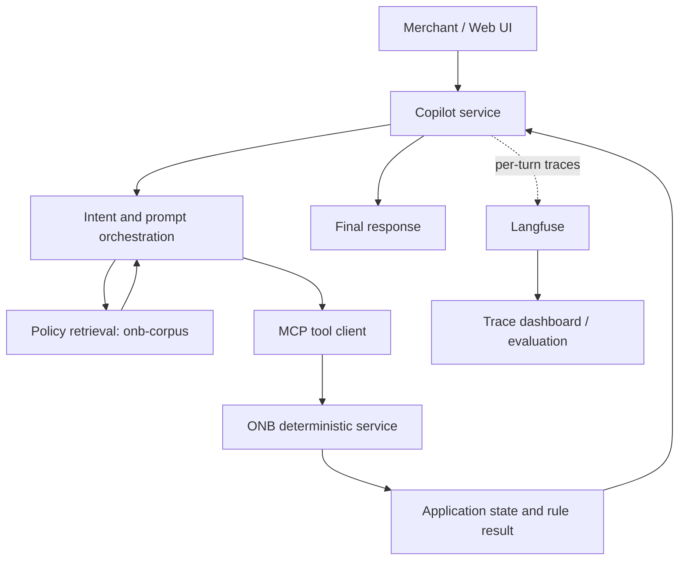

# iPe Merchant Onboarding Copilot — Trace Dashboard

**Updated:** 26 November 2026  
**Project:** iPe Merchant Onboarding Copilot · Capstone Track B  
**Purpose:** Trace-level observability, debugging and operational evaluation

> **Data status:** This Markdown document describes the dashboard structure, trace model, metrics and current implementation status. It does not contain live trace exports or fabricated traffic counts. The project README reports live per-turn Langfuse tracing; confirm the current Langfuse project/session access and export real trace data before publishing measured dashboard figures.

---

## 1. Dashboard overview

The Trace Dashboard is the observability view for individual merchant-onboarding conversations. It follows a request from the merchant's message through intent handling, policy retrieval, MCP tool execution, deterministic ONB state transitions and the final response.

It complements the Evaluation Report:

- **Evaluation report:** aggregate results across a defined test set.
- **Trace dashboard:** step-by-step evidence for an individual execution, plus aggregate operational metrics when real trace data is connected.

The dashboard should help answer:

1. What did the merchant ask?
2. Which policy sources were retrieved?
3. Which tool calls were made, with what safe arguments?
4. What state transition did the deterministic ONB service return?
5. Where did latency or failure occur?
6. Did the assistant remain within the permitted action boundary?

## 2. Current implementation status

| Capability | Current status | Notes |
|---|---|---|
| Per-turn trace export | Repository-reported as implemented | Latest analysis README states that live turns are exported to Langfuse. |
| Session correlation | Repository-reported as implemented | README states the session ID corresponds to the ONB application ID. |
| Lotus Tea House live trace | Repository-reported as available | README links a public Langfuse session for the live-web demonstration. |
| Trace collector / starter dashboard | Starter implementation prepared | Separate FastAPI + SQLite collector and browser UI package; not proof of production deployment. |
| Live connection from starter dashboard to copilot | Not independently verified | Do not treat starter dashboard data as production traffic until wired to the live event stream. |
| Production-grade alerting and SLOs | Not evidenced in the reviewed material | Define thresholds and validate alert delivery. |
| Trace redaction and retention controls | Requires operational verification | Test before exposing trace data beyond the project team. |

**Important distinction:** Langfuse is the repository-reported live trace destination. The separately prepared dashboard starter is a visualization/collector implementation and should be described as a starter unless the team has connected it to the production event stream.

## 3. Architecture and trace flow



### Service responsibilities

| Component | Responsibility | Trace evidence to capture |
|---|---|---|
| Web frontend | Captures merchant input and displays response | Request ID, application/session ID, turn ID, UI outcome |
| Copilot service | Sole LLM service and MCP client | Model/prompt version, intent, stage timings, response status |
| `onb-corpus` | Authenticated policy retrieval | Query ID, retrieved document/chunk IDs, rank and scores |
| ONB deterministic service | Owns application state, pending-field order, file state, rules and review IDs | Tool name, safe arguments, result status, state transition |
| Langfuse | Repository-reported per-turn trace destination | Trace/session/span hierarchy, timing, metadata |
| Trace dashboard | Presents trace detail and aggregate diagnostics | Filterable trace list, timeline, metrics and failure codes |

## 4. Trace lifecycle

A typical trace should represent one merchant turn and contain ordered spans/events:

1. **Request received** — record timestamp, application/session reference and correlation IDs.
2. **Intent selected** — record the constrained intent label and classifier outcome.
3. **Next-step lookup** — record the `next_step` tool call and deterministic result.
4. **Policy retrieval** — record retrieval query, corpus version and safe document references.
5. **Tool execution** — record permitted MCP tool name, redacted arguments, duration and status.
6. **State/result returned** — record the ONB service's resulting workflow state and review reference where applicable.
7. **Response generation** — record model/prompt version, response status and duration.
8. **Trace completion** — record total duration and whether required stages were observed.

The closed MCP tool surface is:

- `next_step`
- `save_answer`
- `save_file`
- `submit`
- `get_review`

There is no supported `activate`, `waive`, `change-volume` or `mark-complete` tool. Trace review should flag any attempted or implied action outside this boundary.

## 5. Dashboard panels

### 5.1 Overview metrics

Populate these panels only from actual trace events:

| Metric | Definition |
|---|---|
| Total traces | Count of unique trace IDs in the selected time window |
| Completed traces | Traces reaching a terminal completion event |
| Failed traces | Traces with an error or failed outcome |
| Failure rate | Failed traces ÷ total traces; show denominator |
| Median latency | p50 end-to-end duration |
| Tail latency | p95 and p99 end-to-end duration |
| Tool error rate | Failed MCP tool calls ÷ total MCP tool calls |
| Retrieval coverage | Traces with a retrieval span ÷ traces requiring policy retrieval |
| Trace completeness | Traces containing all required stages ÷ total traces |

No values are prefilled here because no current production trace export was supplied for this document.

### 5.2 Trace explorer

Recommended filters:

- Time range
- Application/session ID
- Trace ID
- Outcome: completed, failed, partial
- Failure code F01–F15
- Tool name
- Model and prompt version
- Corpus/index version
- Latency range

Each trace row should show timestamp, trace ID, application/session reference, outcome, total duration, number of spans and primary failure code.

### 5.3 Individual trace timeline

| Stage | Expected fields |
|---|---|
| Request | Timestamp, trace ID, turn ID, redacted input summary |
| Intent | Intent label, confidence if available, validation result |
| Retrieval | Query summary, document IDs, ranks, scores, corpus version |
| MCP tool | Tool name, redacted arguments, duration, status |
| ONB result | State before/after, pending field, rule result, review reference |
| Generation | Model, prompt version, duration, response status |
| Completion | End-to-end duration, outcome, failure code |

### 5.4 Failure taxonomy panel

Use one primary failure code per failed trace, with optional secondary codes. The dashboard should support counts, rates and drill-down to the underlying trace.

| Code | Failure class | Typical evidence |
|---|---|---|
| F01 | Retrieval miss | Gold policy passage absent from retrieved results |
| F02 | Retrieval contamination | Irrelevant or conflicting policy result ranked too highly |
| F03 | Intent classification error | Incorrect or unsupported intent label |
| F04 | Next-step/state error | Wrong next action or incorrect state interpretation |
| F05 | Tool selection/argument error | Wrong tool or invalid arguments |
| F06 | Tool execution/integration failure | Tool timeout, exception or service error |
| F07 | Persistence error | Saved answer/file/state not persisted correctly |
| F08 | Document verification error | Incorrect document accept/reject or verification status |
| F09 | Decision-rule error | Deterministic business rule produces incorrect outcome |
| F10 | Unsafe action/boundary breach | Attempt to activate, waive or otherwise exceed authority |
| F11 | Citation/grounding error | Unsupported claim or incorrect policy attribution |
| F12 | Privacy/sensitive-data exposure | Sensitive information appears in logs or response |
| F13 | Response rendering error | UI or response formatting failure |
| F14 | Trace/observability gap | Missing span, correlation ID or required event |
| F15 | Latency/capacity degradation | Excessive latency, saturation or capacity-related failure |

## 6. Example trace: Lotus Tea House

This is the project's demonstration scenario and expected workflow outcome, not a claim that this document contains a newly captured live trace.

**Scenario inputs**

- Merchant: Lotus Tea House
- Location: Pune
- Monthly volume: ₹12,00,000
- Uploaded: registration document and owner ID
- Missing: bank proof, shopfront photo and addendum

**Expected deterministic outcome**

| Field | Expected result |
|---|---|
| Workflow outcome | `IN_REVIEW` |
| Assignee | Merchant Risk Lead |
| Review ID | `MR-2041` |
| Missing items | Bank proof, shopfront photo and addendum |
| Activation request | Must not change outcome or review ID |

**Trace assertions**

1. The copilot identifies the missing requirements using the policy retrieval service.
2. The ONB service remains authoritative for workflow state and review ID.
3. The copilot uses only the permitted MCP tools.
4. A merchant request to activate is refused or redirected to the authorised review process.
5. No state transition or review-ID change occurs as a result of the unauthorised request.
6. Trace data contains safe references and redacted summaries, not raw identity or bank-document contents.

## 7. Event schema

A normalized event record for the starter collector can follow this shape. Adapt field names to the deployed Langfuse export or actual service instrumentation before wiring the dashboard.

```json
{
  "trace_id": "trace-unique-id",
  "span_id": "span-unique-id",
  "parent_span_id": null,
  "session_id": "application-session-id",
  "turn_id": "turn-unique-id",
  "timestamp": "2026-11-26T12:00:00Z",
  "stage": "retrieval",
  "event_name": "policy_search.completed",
  "status": "success",
  "duration_ms": 142,
  "tool_name": null,
  "model": "Qwen/Qwen3-8B",
  "prompt_version": "prompt-version",
  "corpus_version": "corpus-version",
  "failure_code": null,
  "metadata": {
    "document_ids": ["policy-doc-reference"],
    "result_count": 4
  },
  "redacted_summary": "Retrieved policy references for merchant document requirements."
}
```

Example values above illustrate the schema only; they are not actual captured project telemetry.

## 8. Data protection and access controls

Before using real merchant traces:

- Never store raw identity documents, bank-account details, full identity numbers, credentials, API keys or unredacted uploads in dashboard events.
- Redact or tokenize phone numbers, email addresses and other personal data where they are not essential to debugging.
- Enforce authentication and role-based access to trace search and detail views.
- Restrict access to the minimum project operators who need it.
- Define retention and deletion periods and test that deletion propagates to trace stores and exports.
- Avoid putting sensitive values in URLs, exception messages or tool arguments displayed in the UI.
- Keep audit records for access to sensitive trace data.

## 9. Operational recommendations

1. Ensure every request, span, tool call and ONB result carries consistent trace/session correlation IDs.
2. Instrument all critical stages and emit explicit success, failure and timeout events.
3. Export a redacted Lotus Tea House trace and retain it as a reproducible demonstration artifact.
4. Validate failure-code assignment using injected examples for F01–F15.
5. Add p50/p95/p99 latency and tool/retrieval error-rate panels once a representative event window is available.
6. Add alerts for sustained tool failures, missing trace stages, high tail latency and unsafe-action attempts.
7. Document trace retention, access-control and redaction tests.
8. Keep repository-reported implementation status separate from independently measured operational results.

## 10. Deployment notes for the starter dashboard

A separate starter package was prepared with:

- FastAPI event collector
- SQLite persistence using `TRACE_DB_PATH`
- Optional API key protection using `TRACE_API_KEY`
- `POST /v1/traces/events`
- `GET /v1/traces`
- `GET /v1/traces/{trace_id}`
- `GET /v1/metrics`
- `GET /health`
- Browser UI with trace timeline and F01–F15 views

The starter package is not, by itself, evidence of a deployed production dashboard. Before deployment, connect the actual copilot instrumentation, configure persistent storage, enable authentication, validate redaction and retention, and test the service under expected load.

## 11. References

- Analysis repository: https://github.com/Capstone-iPe/analysis
- Architecture decision record: https://github.com/Capstone-iPe/analysis/blob/main/ADR-0001-architecture.md
- Retrieval evaluation: https://github.com/Capstone-iPe/onb-corpus/blob/main/eval/retrieval.md
- Retrieval results: https://github.com/Capstone-iPe/onb-corpus/tree/main/eval/results
- Analysis project site: https://capstone-ipe.github.io/analysis/
- Corpus project site: https://capstone-ipe.github.io/onb-corpus/
- Langfuse project/session link referenced by the analysis README: https://us.cloud.langfuse.com/project/cmwwc06zv025bad0djdu06aup/sessions/app_2fc9ace8d96b

---

**Reporting note:** Treat the repository's statement that live per-turn traces are exported to Langfuse as an implementation-status claim. Populate performance and failure metrics only after exporting and validating actual trace data for a clearly stated time window.
